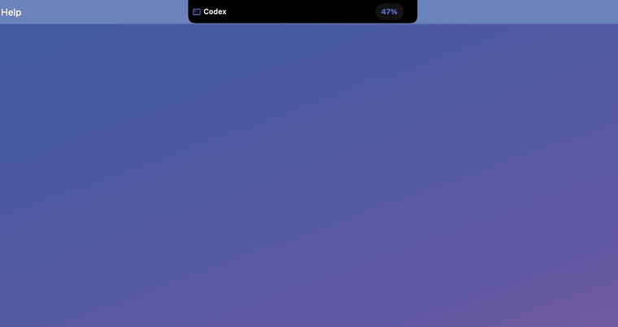
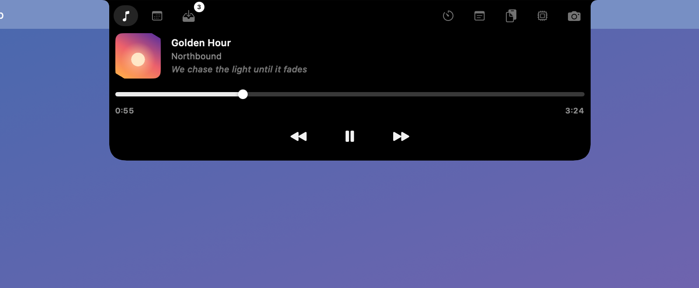
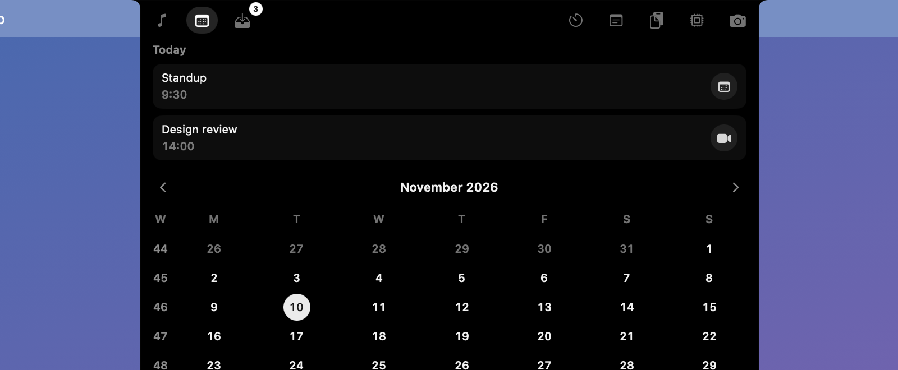
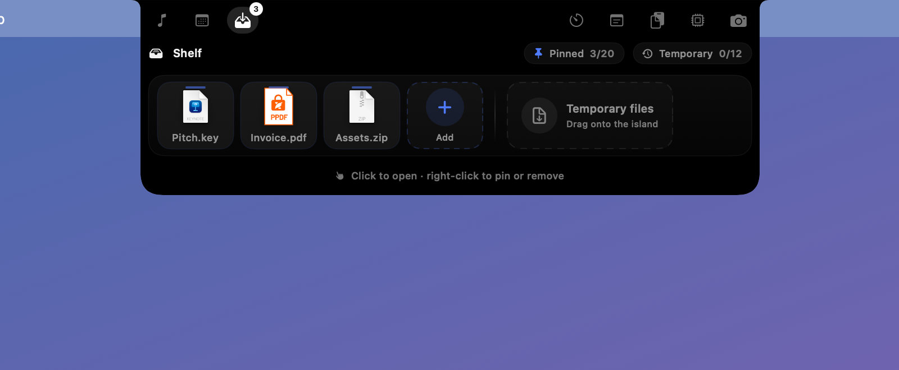
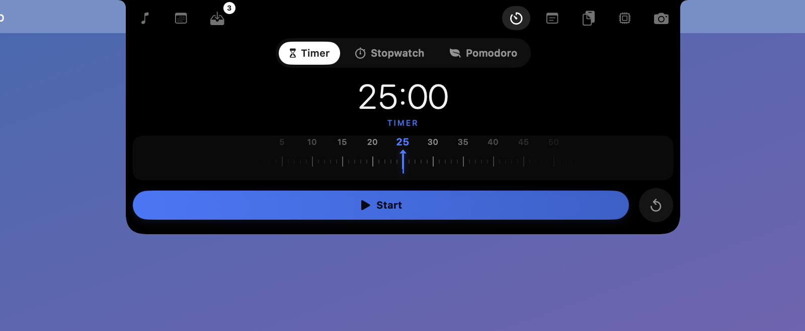
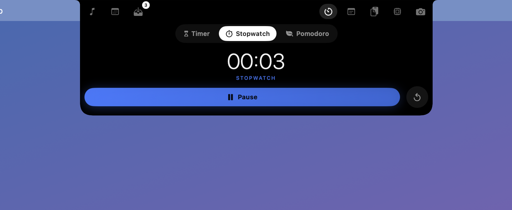
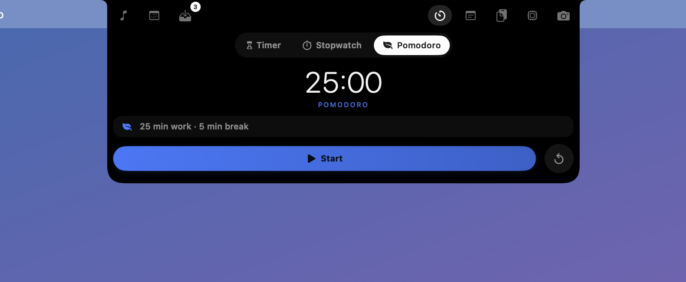
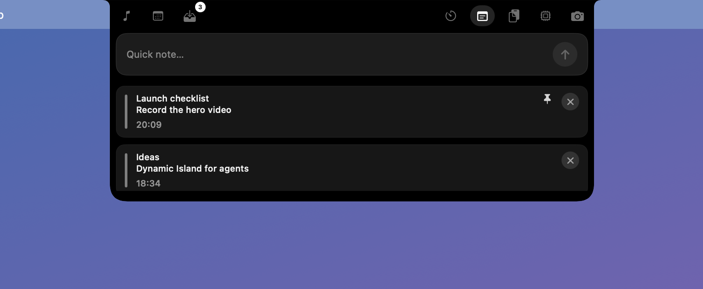
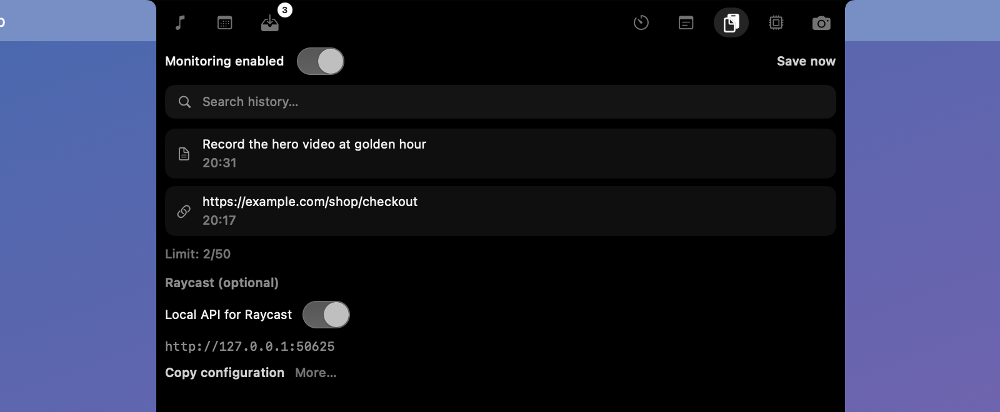
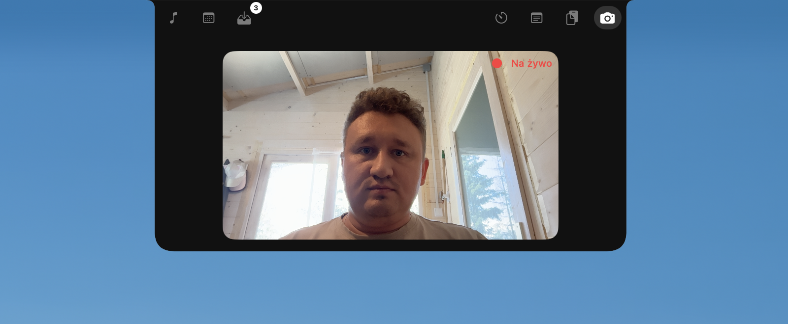

# NotchFlow

Your coding agents and daily controls in an island at the top of your Mac's screen. Approve Claude Code from the notch, watch Claude, Codex and Cursor usage limits, and keep music, files and timers one hover away. Native, open source, privacy-first.

[](https://github.com/Tymcio/notchflow/actions/workflows/ci.yml)
[](LICENSE)

**[Download](https://github.com/Tymcio/notchflow/releases/latest)** · **[Website](https://notchflow.eu)** · **[Roadmap](docs/roadmap.md)** · **[Free vs Premium](docs/free-vs-premium.md)** · **[Contributing](CONTRIBUTING.md)**

<p align="center">
  
</p>

<p align="center"><em>Hover the top of your screen — the island expands into coding agents, music, calendar, shelf, timers, notes, clipboard, and mirror.</em></p>

---

## What is NotchFlow?

NotchFlow turns the top of your screen into a useful, non-intrusive island — a floating `NSPanel` around the physical notch on a MacBook, or a small capsule in the middle of the menu bar on Macs and displays without one (Mac mini, Mac Studio, iMac, external monitors). With several displays, the island follows your cursor or stays on the display you pick in Settings.

- Menu bar app (no Dock icon) — look for the capsule icon after launch
- Hover the **top-center of your screen** to expand the island
- Built with SwiftUI + AppKit, distributed as a signed & notarized DMG with Sparkle updates

## Coding agents

The Agents add-on keeps an eye on your AI coding agents while you work in other windows:

- **Allow / Deny in the island** for Claude Code, Codex, Copilot CLI and Qwen Code: read the exact command and answer the permission prompt there (each agent's own `PermissionRequest` hook)
- **Session status** for Claude Code, Codex, Copilot CLI, Qwen Code, Gemini CLI, OpenCode, Kilo Code, Crush, Droid, Cursor and Grok Build: running, waiting for you, or done, with one click back to the right terminal or editor. Status-only agents pulse the island when they ask for permission and keep the prompt in the agent
- **One click to connect**: Settings lists the agents installed on your Mac; Connect adds NotchFlow's hooks, Disconnect removes only NotchFlow's entries
- **Usage limits**: remaining 5-hour and weekly quota for Claude and Codex with reset times, Cursor's included usage, Grok Build and Grok Bot weekly limits
- Reuses the logins already on your Mac; requests go only to Anthropic, OpenAI, Cursor and xAI. Status-only hooks never answer permission prompts for you

Setup and details: [docs/agents.md](docs/agents.md)

## Features

| Area | Free | Premium |
|------|------|---------|
| **Island** | Default size, system theme | Custom width, clipboard height, Midnight / Aurora / Ember themes |
| **Media** | Spotify & Apple Music controls, artwork, scrubber | + Lyrics snippet |
| **Shelf** | 1 item (drop on island) | Up to 12 items, multi-file ZIP staging |
| **Notes** | 5 quick notes | Unlimited + pin |
| **Clipboard** | 5 entries (opt-in monitoring) | 50 entries + search |
| **Mirror** | Tab visible (locked) | Live camera preview |
| **Calendar** | Month grid + upcoming preview | — |
| **HUD** | Volume and brightness levels in the notch (the macOS indicator still shows) | — |
| **Integrations** | URL scheme, local API (media) | Local API (notes, clipboard, mirror) |
| **Notifications** | — | App alerts in notch, hide body, close system banner |
| **Hide mode** | — | Hide island for selected apps (settings panel) |

Full breakdown: **[docs/free-vs-premium.md](docs/free-vs-premium.md)** · Full plan: **[docs/roadmap.md](docs/roadmap.md)**

## Roadmap

Planned releases **v1.1 → v1.3** and status of each item. ✅ = shipped today · 📋 = planned.

| Release | Feature | Status |
|---------|---------|--------|
| **Shipped** | Hover island, media, calendar, shelf, focus timer, notes, clipboard, mirror | ✅ |
| **Shipped** | Volume and brightness levels in the notch, URL scheme, local API, Raycast | ✅ |
| **Shipped** | Localization (en, pl, de, it, es) + in-app language picker | ✅ |
| **Shipped** | App notifications in the notch (Premium) | ✅ |
| **Shipped** | Close system banner when notification appears in island (Premium) | ✅ |
| **v1.1** | Album art colors (gradient from artwork) | 📋 |
| **v1.1** | Spring animations (+ reduce motion setting) | 📋 |
| **v1.1** | HUD redesign + keyboard backlight HUD | 📋 |
| **v1.1** | Auto-hide island in fullscreen | 📋 |
| **v1.1** | Screen capture privacy (hidden in screenshots / recordings) | 📋 |
| **v1.2** | Energy budget & published idle CPU numbers | 📋 |
| **v1.2** | Battery / charging idle live activity | 📋 |
| **v1.2** | License enforcement + trial on stable builds | 📋 |
| **v1.3** | AirDrop from shelf (Premium) | 📋 |
| **v1.3** | Bluetooth connect / disconnect + device battery | 📋 |
| **v1.3** | Caffeine toggle (prevent sleep) | 📋 |
| **v1.3** | Audio output switch in media view | 📋 |

Details, tier assignment, and non-goals: **[docs/roadmap.md](docs/roadmap.md)**

## Screenshots

| Music | Calendar | Shelf |
|:---:|:---:|:---:|
|  |  |  |

| Timer | Stopwatch | Pomodoro |
|:---:|:---:|:---:|
|  |  |  |

| Notes | Clipboard | Mirror |
|:---:|:---:|:---:|
|  |  |  |

## Requirements

- macOS 14.0 (Sonoma) or later
- Apple Silicon (ARM64)
- Xcode 15+ / Swift 5.9+

## Download

Official builds (signed, notarized, with premium activation):

- **[Latest release](https://github.com/Tymcio/notchflow/releases/latest)** — drag `NotchFlow.app` to Applications
- **Homebrew** — `brew tap tymcio/tap && brew trust --cask tymcio/tap/notchflow && brew install --cask notchflow`
- **[notchflow.eu](https://notchflow.eu)** — purchase premium license

Verify the signature:

```bash
spctl -a -vv /Applications/NotchFlow.app
codesign -dv --verbose=4 /Applications/NotchFlow.app
```

## Build from source

```bash
git clone https://github.com/Tymcio/notchflow.git
cd notchflow
swift build -c release
Scripts/package_app.sh   # bundles Sparkle.framework — required
open build/NotchFlow.app
```

> **Important:** Do not run the raw binary from `.build/` — it will crash without `Sparkle.framework`. Always use `Scripts/package_app.sh` or `Scripts/compile_and_run.sh`.

See [docs/polar-setup.md](docs/polar-setup.md) for checkout and license configuration.

Self-built copies run all free features. Premium features require a license from [notchflow.eu](https://notchflow.eu).

## Development

```bash
swift test
Scripts/compile_and_run.sh
```

Performance budget (idle): ~0% CPU, < 50 MB RAM. See [docs/performance.md](docs/performance.md).

## Integrations

- **Raycast** — local HTTP API + extension in [`integrations/raycast/`](integrations/raycast/notchflow/)
- **URL scheme** — `notchflow://play-pause`, `show-island`, `add-note?text=…`, `mirror-toggle`

Setup guide: [docs/raycast-integration.md](docs/raycast-integration.md)

## Security & privacy

- No telemetry in v1.0
- Clipboard monitoring is **opt-in** and stored locally
- Local API binds to `127.0.0.1` only; token in Keychain
- Network use limited to license validation (Polar), Sparkle updates, optional lyrics, and Claude, Codex, Cursor, Grok Build, and Grok Bot usage when the Agents addon is enabled
- No Terminal install scripts — drag-to-Applications only

Details: [website/privacy.html](website/privacy.html) · [website/security.html](website/security.html)

## Project structure

```
Sources/NotchFlow/     App, features, licensing, views
Tests/                 Swift Testing suite
Scripts/               Build, package, release tooling
docs/                  Performance, integrations, roadmap, public-repo guide
integrations/raycast/  Raycast extension (MIT)
website/               Static marketing site (notchflow.eu)
```

## License

Source code is available under **[GPL-3.0](LICENSE)**. You may build and run NotchFlow from source for personal use.

Official signed builds and premium feature activation require a license from [notchflow.eu](https://notchflow.eu). The Raycast extension is [MIT](integrations/raycast/notchflow/package.json).

## Contributing

See [CONTRIBUTING.md](CONTRIBUTING.md). When publishing updates, follow [docs/public-repository.md](docs/public-repository.md).
